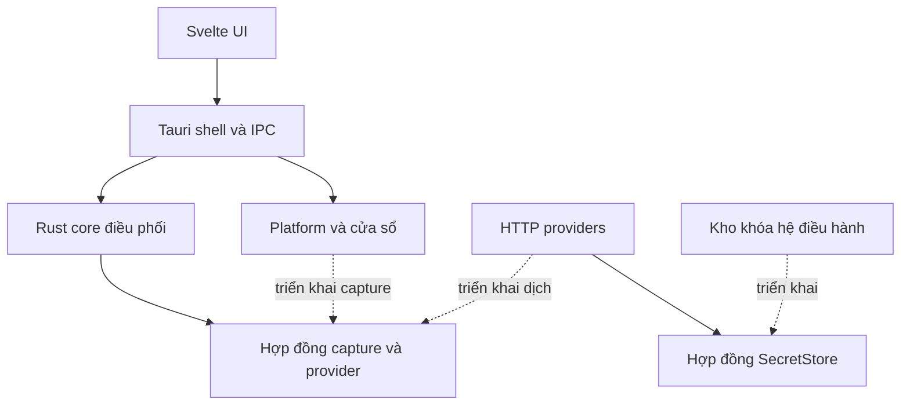
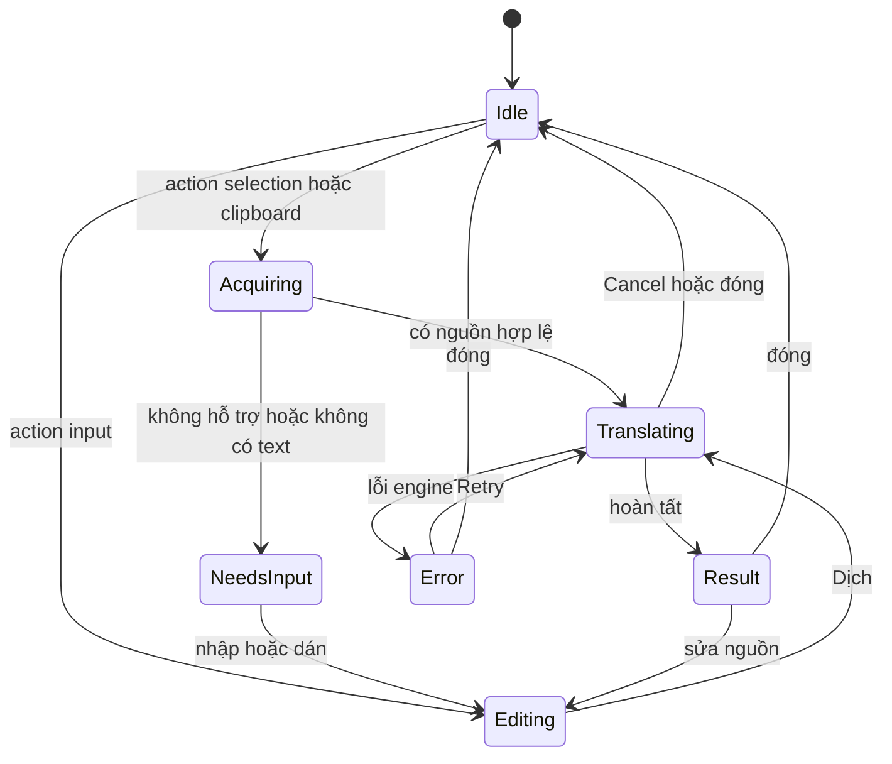

# Thiết kế sản phẩm ứng dụng dịch nhanh trên Windows và Ubuntu

**Phiên bản:** 1.0 — bản hợp nhất để duyệt thiết kế  
**Ngày rà soát:** 16/11/2026  
**Stack:** Rust + Tauri 2 + Svelte + TypeScript  
**Nguồn tham chiếu:** MoePeek, commit `15ec28e70142aae9eb212ddfafe388e9a827354e`, cấu hình phiên bản 0.21.0  
**Trạng thái:** đã hoàn thành phân tích và thiết kế tài liệu; chưa triển khai ứng dụng, chưa thực hiện PoC.

## 0. Cách sử dụng tài liệu và quyết định tổng thể

Đây là bản đặc tả hợp nhất thay thế hai báo cáo đầu vào về mặt định hướng sản phẩm. Các nhận định về mã nguồn được ưu tiên theo commit đã đọc trực tiếp, không theo tài liệu tự động của commit cũ. “Cuối cùng” ở đây là baseline thiết kế v1.0 có thể giao cho người hoặc AI triển khai sau khi được duyệt; không có nghĩa mọi rủi ro hệ điều hành đã được kiểm chứng.

Quy ước bằng chứng:

- **[SRC]**: đã kiểm tra trực tiếp mã nguồn MoePeek tại commit trên.
- **[DOC]**: đã đối chiếu tài liệu chính thức; chưa đồng nghĩa đã chạy thành công trên máy đích.
- **[DESIGN]**: quyết định thiết kế đề xuất của sản phẩm mới.
- **[POC]**: giả định cần thử nghiệm; chỉ được nâng thành cam kết hỗ trợ sau khi có bằng chứng.

### 0.1. Quyết định chủ đạo

1. **Windows và Ubuntu GNOME Wayland cùng là nền tảng ưu tiên.** X11 là đường hỗ trợ bổ sung; không làm Windows xong toàn bộ rồi mới phát hiện rủi ro Wayland.
2. **Trải nghiệm cốt lõi:** lấy văn bản do người dùng chủ động chọn → kích hoạt dịch → xem kết quả nhanh về tiếng Việt. Windows/X11 ưu tiên popup không lấy focus khi mở; GNOME Wayland dùng cửa sổ dịch gọn có focus khi cần, vị trí do compositor quyết định.
3. **Ba điểm vào rõ ràng:** Dịch vùng chọn, Dịch clipboard, Nhập văn bản. Thất bại khi lấy vùng chọn không được tự động gửi clipboard cũ lên mạng.
4. **MVP chỉ một engine tự động.** Ưu tiên thử Azure Translator F0 làm đường dịch máy chính thức có hạn mức miễn phí; không dùng LLM hoặc endpoint web không chính thức làm điều kiện bắt buộc của MVP.
5. **Core độc lập với UI.** Provider, platform adapter và kho bí mật có hợp đồng riêng; chưa cần plugin động, daemon, Python hay cơ sở dữ liệu.
6. **Bảo mật và quyền riêng tư có ngay từ lát cắt đầu tiên:** kho khóa hệ điều hành, xử lý dữ liệu theo phiên, không lịch sử/telemetry mặc định, không giả lập Copy bừa vào terminal.
7. **PoC nền tảng là cổng trước phát triển đầy đủ.** Có đường fallback dùng được chưa đủ để quảng bá “dịch vùng chọn ở mọi ứng dụng”.

### 0.2. Phạm vi đã thực hiện

Đã đọc hai báo cáo đầu vào; clone và kiểm tra mã, các module quan trọng và các test liên quan; đối chiếu thêm tài liệu Ubuntu/GNOME, portal, Tauri/Tao, Windows, AT-SPI, Azure Translator và hệ sinh thái kho khóa Rust. Không chạy MoePeek trên macOS, không thử gọi dịch vụ bằng key thật, không đo latency/RAM và không kiểm thử trên Windows/Wayland. Không có thông số hiệu năng thực nghiệm trong tài liệu này.

Tài liệu gồm BA → yêu cầu sản phẩm → UX → thiết kế kỹ thuật → PoC → kiểm thử/nghiệm thu → phát hành. Các bước nghiên cứu người dùng, kiểm chứng chất lượng dịch, PoC và UAT được đặc tả để thực hiện, không được ghi là đã hoàn thành.

## 1. Hợp nhất và sửa các khác biệt giữa hai bản rà soát

| Nhận định đầu vào | Kết luận sau đối chiếu | Tác động thiết kế |
|---|---|---|
| Bản gửi thêm dựa chủ yếu trên DeepWiki tại `89ca067c` | Dùng mã trực tiếp tại `15ec28e…` làm chuẩn [SRC] | Không dùng số dòng hoặc trạng thái từ commit cũ như bằng chứng hiện tại |
| Phase gốc là `idle → grabbing → active` | Enum hiện tại có `idle`, `active`; capture được điều phối bằng action token [S03] | `Acquiring` là trạng thái đề xuất mới, không phải mô tả mã gốc |
| 14 ngôn ngữ | 14 mã mặc định + 6 mã bổ sung = 20 mã trong catalog [S10] | Phân biệt catalog UI và ngôn ngữ thật sự được từng provider hỗ trợ |
| API key có thể lưu ở Defaults | Đã xác minh: provider đọc key từ Defaults; có migration Keychain → Defaults [S01, S15] | Thay bằng SecretStore ngay từ đầu |
| Xóa provider còn cấu hình | `removeCustomProvider()` đã gọi `cleanupDefaults()` ở commit này [S05, S15] | Không giữ nhận định lỗi cũ; thiết kế mới vẫn cần xóa secret và config nhất quán |
| Test kết nối LLM dùng 1 token | `OpenAIConnectionManager.testConnection()` đặt `max_tokens = 16` [S16] | Test kết nối có thể phát sinh usage; không coi là miễn phí tuyệt đối |
| OCR không có tiếng Việt | Danh sách ưu tiên không có `vi`, đồng thời bật tự phát hiện ngôn ngữ [S08] | Chưa đủ căn cứ kết luận tuyệt đối OCR không đọc được tiếng Việt; cần corpus kiểm thử |
| Ubuntu là Wayland-only | Đúng cho phiên Ubuntu Desktop GNOME hiện tại; không đúng cho mọi desktop/flavor của Ubuntu [P01] | Ubuntu 26.04 GNOME Wayland là mục tiêu chính, Ubuntu 24.04 X11 là cấu hình phụ |
| Wayland không có selection; PRIMARY luôn cần data-control | Không gộp AT-SPI, primary-selection, clipboard thông thường và data-control thành một khả năng | Chọn AT-SPI cho direct capture; background data-control ngoài MVP; không dựa vào kết luận bao trùm mọi compositor |
| Popup giữa màn hình, nhớ vị trí trên Wayland | Không cam kết tọa độ tuyệt đối, khôi phục vị trí hoặc always-on-top bằng Tauri/Tao thông thường [P05] | Nhớ kích thước; compositor đặt vị trí; ghim chỉ có nghĩa không tự đóng |
| Đổi sang Rust, không copy là clean-room | Không tự gọi quá trình đã đọc mã là clean-room theo nghĩa pháp lý chặt chẽ | Ghi provenance; giấy phép phải được duyệt trước khi phát hành |
| Thêm provider chỉ cần một file | Không phải tiêu chí kỹ thuật đáng tin cậy | Tiêu chí đúng: không sửa coordinator/UI nghiệp vụ; có adapter, cấu hình và test hợp đồng |
| Clipboard khôi phục 100% | Không thể hứa cho mọi delayed/custom clipboard format và mọi race của hệ thống | Chỉ tự Copy khi snapshot đủ và backend đã qua test; nếu không, yêu cầu Copy thủ công |

Một số khẳng định đúng trong mã nhưng không nên chuyển nguyên sang sản phẩm mới: ngưỡng nhận diện của Apple, polling quyền macOS, auto-detect chuột mặc định bật, 20 model song song và UI settings nằm trong provider.

## 2. BA — Bài toán, người dùng và giá trị sản phẩm

### 2.1. Problem statement

Người dùng đọc tài liệu, website, PDF và nội dung kỹ thuật bằng ngoại ngữ thường phải sao chép sang tab dịch, chọn ngôn ngữ rồi quay lại công việc. Công cụ mới giảm thao tác chuyển ngữ cảnh, ưu tiên tiếng Việt và hoạt động nhất quán về ý nghĩa trên Windows/Ubuntu, dù cơ chế cửa sổ khác nhau.

**Giá trị chính:** thao tác nhanh, lấy đúng đoạn cần dịch, không làm hỏng clipboard hoặc ứng dụng đang dùng, hiểu rõ dữ liệu được gửi cho engine nào.

**Không phải mục tiêu:** ứng dụng dịch tài liệu hàng loạt, dịch âm thanh/phụ đề, trợ lý chat tổng quát, tự huấn luyện model, đọc mọi vùng màn hình hoặc thay thế công cụ accessibility hệ thống.

### 2.2. Nhóm người dùng và tình huống

| Nhóm/tình huống | Việc cần hoàn thành | Điều quan trọng |
|---|---|---|
| Người đọc tài liệu kỹ thuật, lập trình | Dịch đoạn README, lỗi, mô tả API mà không rời IDE | Giữ tên hàm, đường dẫn, số liệu; terminal không nhận Ctrl+C giả lập sai |
| Người học/nhà nghiên cứu | Dịch đoạn sách, bài báo và PDF chọn được text | Tiếng Việt tự nhiên, giữ ý, dễ sửa đoạn nguồn |
| Người dùng Ubuntu Wayland | Kích hoạt dịch thuận tiện dù capture không được mọi ứng dụng | Fallback có hướng dẫn, không báo thành công giả |
| Người dùng muốn kiểm soát chi phí/dữ liệu | Chọn engine, biết quota, giữ key cá nhân | Không có provider trả phí chạy ngầm; không gửi dữ liệu qua server của dự án |

Đây là giả thuyết persona từ mục tiêu đã nêu, chưa phải kết quả phỏng vấn người dùng. Trước beta: thử 5–8 người hoặc phiên sử dụng độc lập, bao gồm người dùng chính; quan sát cài đặt lần đầu, dịch browser/IDE/PDF, khôi phục từ lỗi và trải nghiệm fallback. Không thu nội dung riêng tư; dùng corpus công khai.

### 2.3. Jobs-to-be-done

- Khi gặp một đoạn ngoại ngữ đang đọc, tôi muốn dịch đoạn đó ngay và tiếp tục công việc trong ứng dụng hiện tại.
- Khi ứng dụng không cho lấy selection, tôi muốn biết một cách thay thế ngắn và chắc chắn hoạt động.
- Khi engine lỗi hoặc hết quota, tôi muốn giữ nguyên đoạn nguồn để thử lại hoặc đổi engine chủ động.
- Khi dùng nội dung nhạy cảm, tôi muốn dừng mọi gửi mạng hoặc chọn engine local đã cấu hình.

### 2.4. Giả định và lựa chọn mặc định

| Mã | Giả định cho v1.0 | Cách xác nhận |
|---|---|---|
| A01 | Ubuntu 26.04.x GNOME Wayland và Windows 11 x64 là hai cấu hình chính | Ghi hệ điều hành thật của máy thử ở M1; không dựa vào số phiên bản nhớ lại |
| A02 | Chấp nhận cửa sổ gọn có focus trên Wayland | UAT xác nhận mức gián đoạn chấp nhận được |
| A03 | Đích mặc định `vi`; có thể chọn đích khác trong catalog provider | Test với người dùng; không khóa cứng kiến trúc chỉ tiếng Việt |
| A04 | Dùng cơ bản miễn phí có thể yêu cầu tài khoản/key và có quota | Thử onboarding F0; nếu không chấp nhận, phải thay đổi mô hình cung cấp dịch vụ |
| A05 | Không yêu cầu dịch offline ngay trong MVP | Không tải model, không chiếm GPU mặc định |
| A06 | Tên, logo và giấy phép phân phối chưa chốt | Không dùng nhận diện MoePeek như tên sản phẩm mới |

### 2.5. Chỉ số thành công

Chỉ số gồm: tỷ lệ cài đặt và hoàn thành lượt dịch đầu tiên; tỷ lệ lấy đúng selection theo từng ứng dụng; độ trễ capture/UI riêng với mạng; tỷ lệ hoàn thành qua fallback; số lỗi clipboard/focus; chất lượng bản dịch trên corpus; CPU/RAM khi idle và sau nhiều phiên. Cách đo và ngưỡng ở mục 12–13. Không dùng số lượt gọi AI hoặc số provider tích hợp làm thước đo thành công.

## 3. PRD — Phạm vi và yêu cầu có thể nghiệm thu

### 3.1. MoSCoW

**Must — MVP:** ba điểm vào; ngôn ngữ đích tiếng Việt; một provider dịch máy chính thức; source/target selector; popup/cửa sổ gọn; Copy/Retry/Cancel; key store; cấu hình có version; phím tắt + fallback mở ứng dụng; single-instance; trang khả năng hệ thống; IME; gói Windows và Ubuntu.

**Should — sau MVP ổn định:** OpenAI-compatible, preset local, Markdown an toàn, engine dịch máy thứ hai, proxy được cấu hình rõ, kiểm tra cập nhật có chữ ký, tùy chọn đổi chiều tự động.

**Could — có nhu cầu và PoC riêng:** OCR tiếng Việt/Anh, TTS, thuật ngữ cá nhân, so sánh hai provider theo yêu cầu, browser extension cho lấy selection chính xác trên web.

**Won't trong v1:** ghi lịch sử mặc định, sync tài khoản/cloud, auto-popup khi rê chuột, nhiều model song song tự động, ảnh/rich text, chatbot, dynamic plugin ABI, GNOME Shell extension, input injection đặc quyền, ARM/macOS/mobile.

### 3.2. Yêu cầu chức năng và liên kết nghiệm thu

| ID | Yêu cầu | Quy tắc/tiêu chí chính | Mốc / test |
|---|---|---|---|
| FR01 | Dịch vùng chọn | Lấy đúng nguồn trước khi đổi focus; thiếu selection không dùng clipboard âm thầm | M3 / T01,T02 |
| FR02 | Dịch clipboard | Người dùng chủ động chọn hành động này; Wayland được mở cửa sổ có focus trước khi đọc | M2–M3 / T03 |
| FR03 | Nhập/chỉnh sửa text | Unicode, xuống dòng; Enter chỉ submit khi không composition; Shift+Enter xuống dòng | M2 / T08 |
| FR04 | Hotkey | Chỉnh được, phát hiện xung đột, hiển thị phím thực portal trả về; có thao tác thử phím | M1,M3 / T04 |
| FR05 | Cửa sổ kết quả | Không tràn màn hình; nguồn, đích, engine, loading/lỗi; chế độ tương thích Wayland | M1–M3 / T05 |
| FR06 | Dịch máy | Azure F0 là ứng viên mặc định; kiểm tra key/region/endpoint và cặp ngôn ngữ | M2 / T06,T11 |
| FR07 | Điều phối phiên | Phiên mới hủy/bỏ kết quả cũ; retry chỉ engine được yêu cầu; một engine tự động | M2 / T07 |
| FR08 | Copy kết quả | Chỉ Copy do người dùng yêu cầu mới thay clipboard; nút Copy toàn bộ chỉ bật khi hoàn tất | M2 / T03,T07 |
| FR09 | Ngôn ngữ | Nguồn auto hoặc thủ công; đích mặc định vi; không tự flip mặc định | M2 / T06,T11 |
| FR10 | Config và secret | Config versioned, atomic write; key ở OS store hoặc chỉ trong RAM phiên | M2 / T09 |
| FR11 | Single-instance/CLI | Chỉ chuyển action ID, không truyền text/key trong process arguments | M1,M3 / T04,T10 |
| FR12 | Khả năng hệ thống | Tách hỗ trợ trực tiếp/cần Copy thủ công/bị từ chối/chưa thử; có “Thử lại” | M1,M3 / T01,T04 |
| FR13 | Quyền riêng tư | Chọn provider trước lần gửi đầu; không giám sát clipboard liên tục; tạm dừng gọi mạng | M2 / T09,T12 |
| FR14 | Giới hạn đầu vào | MVP tối đa 5.000 Unicode scalar values/request hoặc thấp hơn nếu provider giới hạn; không cắt âm thầm | M2 / T06 |
| FR15 | Vòng đời desktop | Đóng cửa sổ dịch giữ tiến trình nếu chạy nền bật; Quit kết thúc; tray không phải đường mở duy nhất | M3,M4 / T10 |
| FR16 | Phát hành | Cài/nâng cấp/gỡ có hành vi dữ liệu rõ; diagnostics có loại bỏ nội dung nhạy cảm | M4 / T09,T10,T12 |

Giới hạn 5.000 là chính sách UX/chi phí của sản phẩm, không phải tuyên bố giới hạn API. Đếm ký tự cho quota do provider quyết định; không lấy bộ đếm này làm số tiền thanh toán chính xác.

### 3.3. Quy tắc nghiệp vụ

- BR01: chỉ gửi nội dung khi có hành động dịch của người dùng và provider đã được chọn. Onboarding giải thích điểm đến dữ liệu một lần; không hỏi xác nhận cho từng lượt dịch thông thường.
- BR02: nguồn rỗng, chỉ khoảng trắng, vùng chọn file hoặc trường mật khẩu được nhận biết thì không gửi.
- BR03: thất bại capture → giữ phiên cũ nếu đang ghim hoặc mở hướng dẫn trống; tuyệt đối không hiển thị clipboard cũ như selection mới.
- BR04: retry/đổi engine là một attempt mới, có thể dùng quota; không gửi lại tự động sau lỗi xác thực/quota.
- BR05: đóng/cancel ngăn cập nhật UI tiếp theo và dừng HTTP nếu có thể; không tuyên bố hủy sẽ hoàn lại usage đã được server xử lý.
- BR06: ghim = không tự đóng khi mất focus; không đồng nghĩa always-on-top trên mọi OS.
- BR07: khi user đổi ứng dụng trong lúc đang chuẩn bị giả lập Copy, dừng capture; không gửi phím sang cửa sổ mới.
- BR08: cùng provider/cùng input đang chạy thì bỏ trigger lặp do key-repeat; hành động chủ động mới sau khi hoàn tất được phép dịch lại.
- BR09: bộ đếm usage cục bộ là ước tính cho riêng ứng dụng; không phải hard cap cho toàn bộ tài khoản Azure hoặc key dùng nơi khác.

### 3.4. User stories và kịch bản chấp nhận

| Story | Given — điều kiện | When — thao tác | Then — kết quả cần có | Truy vết |
|---|---|---|---|---|
| US01 — Dịch tại chỗ | Browser được xác nhận direct support, đã chọn đoạn A | Nhấn Dịch vùng chọn | Chỉ A được gửi đến engine đã chọn; hiển thị nguồn A và đích vi; hành vi focus đúng backend | FR01,FR05 / T01,T05 |
| US02 — Ứng dụng không hỗ trợ | Capture không có kết quả, clipboard còn đoạn B cũ | Nhấn Dịch vùng chọn | B không được gửi; hướng dẫn Copy/Paste xuất hiện, không mất dữ liệu cũ | FR01,FR13 / T01,T03 |
| US03 — Dùng fallback Wayland | Đã Copy đoạn C bằng thao tác đúng của ứng dụng nguồn | Chọn Dịch clipboard | Cửa sổ được yêu cầu activate; đọc C hoặc cho Paste rõ ràng; không ghi đè clipboard | FR02,FR12 / T03,T05 |
| US04 — Phiên dịch mới | Đoạn A đang dịch chậm | Gửi đoạn D | Result A đến muộn bị bỏ; UI chỉ gắn với D và trạng thái attempt hiện tại | FR07 / T07 |
| US05 — Hết quota | Provider trả mã hết quota | Yêu cầu dịch | Giữ nguồn, hiển thị lỗi; không gọi engine khác có phí, không tự nâng tài nguyên | FR06,FR13 / T06,T12 |
| US06 — Kho khóa không khả dụng | Secret Service bị khóa/không có | Nhập key và chọn chỉ dùng trong phiên | Dịch được sau cấu hình hợp lệ; key không xuất hiện trong config/export/log, lần chạy sau cần nhập lại | FR10 / T09 |

Các story trên phải có bằng chứng chạy, không được đánh dấu đạt chỉ vì UI đã có đúng nút hoặc unit test mock đã pass.

## 4. UX và hành vi chi tiết

### 4.1. Thiết lập lần đầu

1. Chọn ngôn ngữ UI Việt/Anh, đích mặc định Việt.
2. Chọn engine, xem thông tin gửi dữ liệu, nhập key/region nếu cần. Không nhúng key dùng chung trong bộ cài; không tự tạo dịch vụ tính phí.
3. Kiểm tra kết nối với câu mẫu công khai, có nhãn “Có thể sử dụng quota”. Người dùng có thể bỏ qua.
4. Thử phím tắt và capture trên một câu mẫu; kết quả đi vào trang Khả năng hệ thống.
5. Với Wayland: hướng dẫn đường portal trước; nếu chưa khả dụng, hướng dẫn gán shortcut hệ thống gọi hành động của ứng dụng hoặc dùng launcher.
6. Chạy nền và tự khởi động là tùy chọn. Autostart mặc định tắt; tránh thông báo xin quyền OCR khi MVP chưa có OCR.

### 4.2. Luồng Windows/X11: dịch vùng chọn

Người dùng chọn text → nhấn hotkey → chụp ngữ cảnh nguồn → capture bằng backend phù hợp → mở kết quả không lấy focus nếu PoC đạt → gọi provider → hiện bản dịch. Click vào cửa sổ chuyển sang tương tác; Esc chỉ hoạt động khi cửa sổ có focus, còn hotkey khi cửa sổ đang mở có thể đóng theo trạng thái quy định.

Không đăng ký Esc toàn cục chỉ để bắt chước macOS. Click ngoài để đóng chỉ bật khi backend thực sự phát hiện được; mất focus không đủ để phát hiện click ngoài một popup vốn chưa từng có focus. Fallback luôn có nút Đóng và hotkey toggle khi cửa sổ của ứng dụng đang hoạt động.

### 4.3. Luồng GNOME Wayland

**Direct:** hotkey portal/launcher → thử AT-SPI khi nguồn vẫn còn focus → lưu text → activate cửa sổ bằng ngữ cảnh/token nếu có → dịch. Cửa sổ có focus là hành vi được chấp nhận; vị trí do compositor chọn.

**Capture không được:** hiển thị “Ứng dụng này chưa cung cấp vùng chọn. Hãy sao chép đoạn cần dịch, rồi dùng Dịch clipboard hoặc dán vào đây.” Không đọc clipboard cũ để tự cứu yêu cầu selection.

**Clipboard:** người dùng dùng thao tác Copy đúng với ứng dụng nguồn → kích hoạt Dịch clipboard → cửa sổ nhận focus → đọc clipboard qua backend thông thường; nếu đọc vẫn không được, ô nhập nhận Ctrl+V/menu Paste. Trong terminal, Copy thường khác Ctrl+C; hướng dẫn không mặc định một tổ hợp cho mọi ứng dụng.

**Activation bị chặn:** báo trạng thái bằng cơ chế khả dụng, giữ nội dung phiên và cho mở từ launcher. CLI + single-instance giải quyết chuyển action, không tự bảo đảm compositor cho focus.

### 4.4. Bố cục giao diện

| Khu vực | Nội dung | Hành vi |
|---|---|---|
| Thanh đầu | Nguồn → đích; tên engine; Ghim, Settings, Đóng | Không che nút khi cửa sổ nhỏ; tooltip bằng ngôn ngữ UI |
| Ô nguồn | Text có thể sửa; nhãn Vùng chọn/Clipboard/Nhập tay | Hiện rõ nguồn; editing không tự gọi API liên tục |
| Vùng kết quả | Loading, bản dịch, lỗi hoặc trạng thái cần thao tác | Giữ phần nguồn khi mạng lỗi; không lẫn kết quả các phiên |
| Thanh hành động | Dịch, Hủy, Copy, Thử lại | Nút phù hợp state; không biến lỗi thành spinner vô hạn |
| Settings | Chung; Engine & khóa; Phím tắt; Khả năng hệ thống; Quyền riêng tư; Giới thiệu | Không đưa tên crate/portal nội bộ vào luồng chính |

Kích thước ban đầu đề xuất khoảng 480×360 logical pixels; giới hạn theo work area. Font hệ thống 14–16 logical pixels, tương phản tốt, hỗ trợ scale chữ và Tab navigation. Không sao chép nguyên cỡ 12 của macOS. Giữ chiều cao kết quả có giới hạn và scroll; không resize theo từng token.

### 4.5. Trạng thái/vi thông báo

| Tình huống | Nội dung hướng người dùng | Hành động |
|---|---|---|
| Không lấy được selection | “Chưa lấy được đoạn đang chọn.” | Hướng dẫn Copy, mở ô nhập |
| Hotkey bị chiếm | “Tổ hợp này đang được sử dụng.” | Chọn tổ hợp khác |
| Portal chưa được cấp | “Phím tắt hệ thống chưa được bật.” | Thử cấp lại hoặc cấu hình thủ công |
| Thiếu key | “Chưa cấu hình dịch vụ dịch.” | Mở cấu hình engine |
| Quota hết | “Dịch vụ báo đã hết hạn mức.” | Giữ nguồn; cấu hình/chọn engine khác chủ động |
| Secret store khóa | “Chưa mở được kho khóa.” | Thử lại hoặc nhập key chỉ dùng trong phiên |
| Mạng lỗi | “Chưa kết nối được dịch vụ.” | Retry thủ công; không mất nguồn |
| Wayland không ghim nổi được | “Ghim giữ cửa sổ mở; thứ tự cửa sổ do hệ thống quản lý.” | Không hứa luôn trên cùng |

## 5. Audit mã nguồn và Feature Matrix chuẩn hóa

### 5.1. Kiến trúc và thiết kế nên giữ

[SRC] AppDelegate nối lifecycle, hotkey, selection monitor và URL scheme. TextSelectionManager dùng AX → Safari AppleScript → clipboard; rich capture đi clipboard trước. SmartTranslationResolver chụp clipboard trước capture để tránh nhận nhầm nội dung do Copy giả lập. Coordinator giữ state mỗi provider, generation và cancellation. Registry mở rộng provider theo model slot, có chế độ on-demand. PopupPanel dùng NSPanel; showAtCursor không activate, showAtScreenCenter activate để nhập. OCR dùng công cụ hệ thống + Vision. [S01–S08]

Giữ ý tưởng: hợp đồng provider thống nhất; lỗi engine độc lập; request generation; clipboard capture có cleanup; kiểm thử race; phân biệt cửa sổ xem và nhập. Thay implementation macOS và bỏ UI/settings khỏi trait provider. Source gốc có các test cho snapshot, hủy tác vụ, on-demand và layout; đây là tài liệu hành vi, không phải chứng minh các nền tảng mới đã đạt. [S19]

### 5.2. Ma trận tính năng

| Tính năng xác minh trong mã | Quyết định bản mới | Ưu tiên | Bằng chứng |
|---|---|---|---|
| Selection bằng hotkey | Giữ hành vi, thay adapter OS | P0 | S01,S02 |
| Smart selection → clipboard snapshot → manual | Thay bằng fallback có chủ đích; Smart tự động không mặc định | P0 | S06 |
| Clipboard/manual/edit nguồn | Giữ | P0 | S03,S12 |
| Tự phát hiện chọn bằng chuột; icon hover/click; app exclusions | Hoãn monitor/icon; giữ loại trừ capture ở mức an toàn | P2/P0 | S09,S13 |
| Hotkey tùy chỉnh, swap và copy từng kết quả | Giữ phần thiết yếu; local shortcuts không chiếm phím ứng dụng nguồn | P0/P1 | S01,S10,S12 |
| Nhận diện có confidence, danh sách đích yêu thích, auto-flip | Provider auto trước; override thủ công; auto-flip tùy chọn sau | P0/P1 | S10,S11 |
| Registry bật/tắt, sắp xếp, on-demand, retry | Giữ hợp đồng; một engine mặc định; on-demand khi mở rộng | P0/P1 | S03,S05 |
| Tối đa 20 model slot/provider | Không đưa vào v1; giới hạn concurrency rõ | P2 | S04,S05 |
| Custom URL/model/prompt; fetch models; connection test | Giữ ở adapter AI mở rộng | P1 | S15,S16 |
| Ollama/LM Studio có khám phá model khác nhau | Dùng preset có discovery riêng, không giả định hoàn toàn đồng nhất | P1 | S17 |
| Google custom HTTP proxy | Chuyển thành cấu hình network có phạm vi; hoãn UI proxy nếu chưa cần | P1 | S14 |
| Markdown render/source/rich; capture RTF/RTFD/HTML, ảnh placeholder | Text-only MVP; Markdown an toàn P1; rich capture ngoài v1 | P0/P1/P2 | S18 |
| Popup drag/resize/pin/remember position/auto-height/font | Giữ có điều kiện theo OS; Wayland không hứa vị trí | P0 | S07,S10 |
| OCR dịch và OCR chỉ copy | Thay backend; thêm corpus tiếng Việt | P2 | S01,S03,S08 |
| Apple TTS, autoplay, tốc độ/giọng theo ngôn ngữ | Thay backend, tắt nền mặc định | P2 | S20 |
| Menu bar, Dock, custom icon, startup, onboarding/quyền | Tray/launcher/settings; dò capability, không bê polling quyền macOS | P0/P2 | S01,S21 |
| Sparkle updater | Thay theo kênh phát hành; signature và rollback có kế hoạch | P1 | S22 |
| PopClip/OpenClip và URL `mopeek://translate` | Loại tích hợp riêng macOS; CLI action nội bộ P0 | P0 | S01,S23 |
| Model metadata từ models.dev | Hoãn; không cần một request mạng phụ cho MVP | P2 | S24 |

Không thấy triển khai persistence lịch sử dịch trong các luồng Core/Services/Settings đã đọc. Điều này là phạm vi rà soát, không phải chứng nhận toàn repository không có bất kỳ lưu trữ/cache nào. Bản mới chủ động không lưu lịch sử và không có HTTP response cache trên đĩa.

### 5.3. Các provider có trong bản gốc

[SRC] Registry đăng ký Google, Bing, Youdao; DeepL, DeepLX, Baidu, NiuTrans, Caiyun; OpenAI, DeepSeek, GLM, OpenRouter, Requesty, Anthropic, Ollama, LM Studio; Apple Translation theo điều kiện hệ thống; custom OpenAI-compatible. [S05]

Google gọi endpoint GTX; Bing lấy token từ trang web, cắt text ở 1.000 ký tự và thêm thông báo; Youdao có ký và giải mã phản hồi web. Đây là implementation đang có, chưa được gọi thử trong audit này. Không suy ra availability, miễn phí dài hạn hay chất lượng từ việc tồn tại class. [S14]

Apple Translation dùng framework và language pack hệ thống. Ollama không phải thay thế tương đương về dung lượng, tốc độ, độ phủ ngôn ngữ hoặc trải nghiệm cài đặt; local inference là tính năng tùy chọn sau MVP.

## 6. Chiến lược engine dịch và chi phí

### 6.1. Lựa chọn đề xuất

| Engine | Vai trò | Lý do / giới hạn |
|---|---|---|
| Azure Translator Text, tài nguyên F0 | Ứng viên engine MVP | API chính thức, có vi và auto-detect; 2 triệu ký tự/tháng miễn phí theo trang giá tại ngày rà soát [P10,P11] |
| OpenAI-compatible | P1: nâng chất lượng/ngữ cảnh theo nhu cầu | BYOK, tùy model có phí; streaming và prompt; không bật ngầm |
| Ollama/LM Studio | P1: endpoint local có sẵn của người dùng | Không đóng gói server/model; không mặc định cần GPU; chất lượng/latency cần benchmark riêng |
| DeepL hoặc engine chính thức thứ hai | P1 | Chọn sau test cặp ngôn ngữ/điều kiện tài khoản; không tích hợp chỉ để tăng số lượng |
| LibreTranslate self-host endpoint | P1/P2 tùy nhu cầu | Người dùng tự có server; không hứa endpoint công cộng miễn phí sẵn có |
| Google GTX, Bing web, Youdao web, DeepLX | Ngoài MVP ổn định | Adapter thử nghiệm tùy chọn sau kiểm tra điều kiện sử dụng; không gọi là API chính thức của dịch vụ gốc |

Azure là bổ sung mới, không phải tính năng MoePeek đã có. Đây là lựa chọn cần PoC chất lượng và onboarding; không tạo tài khoản hay tài nguyên trong giai đoạn thiết kế này.

### 6.2. Ý nghĩa “miễn phí cơ bản”

Ứng dụng không thu phí sử dụng cơ bản và không vận hành proxy thương mại bắt buộc. Người dùng cấu hình tài nguyên F0 riêng, sử dụng trong quota của dịch vụ. Tài khoản, điều kiện đăng ký và việc cung cấp thông tin thanh toán phải được kiểm tra khi onboarding thực tế; không cam kết không cần thẻ/tài khoản.

Tài liệu Azure mô tả mã `403001` khi vượt free quota [P12]. Ứng dụng dừng và báo lỗi, không tự nâng tier hoặc đổi sang engine trả phí. Phân biệt hạn mức miễn phí **theo tháng** trên trang giá và throttle **theo giờ** trong service limits [P10,P13]. Không coi mọi Azure resource hoặc key được nhập là F0; trạng thái tier do người dùng xác nhận phải được ghi “chưa xác minh” nếu ứng dụng không có quyền quản trị để kiểm tra.

Nếu yêu cầu sau này là “không tài khoản, không key, không quota, dịch online ngay”, cần một quyết định sản phẩm mới: kinh phí server chung hoặc chấp nhận endpoint không chính thức. Không giả vờ đã đáp ứng yêu cầu đó bằng BYOK.

### 6.3. Ngôn ngữ và chất lượng

MVP để provider tự nhận diện nếu hỗ trợ; Azure Translate có auto-detect khi bỏ `from`, trả ngôn ngữ/confidence trong phản hồi [P14]. Người dùng luôn sửa được nguồn. Không sao chép ngưỡng 0.3/0.5 của NLLanguageRecognizer sang engine khác vì điểm confidence không được hiệu chuẩn giống nhau.

Đích vi cố định theo lựa chọn người dùng, auto-flip tắt. Nếu muốn dịch Việt → Anh, chọn đích en hoặc dùng preset riêng. Không gọi dịch lần hai chỉ để auto-flip sau khi đã nhận kết quả.

Corpus nghiệm thu đề xuất: 100 đoạn công khai EN→VI (tài liệu kỹ thuật, câu thông dụng, PDF, lỗi phần mềm), 30 đoạn JA/KO/ZH→VI và 20 đoạn VI→EN. Gồm câu ngắn, nhiều nghĩa, trộn code, số, URL, thuật ngữ và dòng ngắt. Chấm nghĩa/thuật ngữ/khả năng đọc thang 1–5; mục tiêu ít nhất 90% đoạn EN→VI đạt ≥4 về nghĩa, không có đảo nghĩa nghiêm trọng ở bộ ví dụ quan trọng đã định trước. Cần người hiểu ngôn ngữ đánh giá; model chấm tự động chỉ hỗ trợ, không phải bằng chứng duy nhất.

## 7. Khả năng nền tảng và thiết kế fallback

### 7.1. Mức hỗ trợ dự kiến, chưa phải kết quả kiểm thử

| Cấu hình | Ưu tiên | Direct selection | Hotkey | Cửa sổ |
|---|---|---|---|---|
| Windows 11 x64 | Chính | UIA → Copy có kiểm soát | Tauri global-shortcut/Win32 | Không activate khi mở kết quả nếu PoC đạt; click để tương tác |
| Ubuntu 26.04.x GNOME Wayland | Chính | AT-SPI; không injection ở MVP | GlobalShortcuts portal → shortcut hệ thống/launcher | Compositor đặt vị trí; activate có chủ đích sau capture |
| Ubuntu 24.04 X11 | Bổ sung | AT-SPI → PRIMARY được xác minh → Copy có kiểm soát | X11 global shortcut | Đặt gần chuột, WM hints; cần test |
| Ubuntu 24.04 GNOME Wayland | Bổ sung | AT-SPI | Dò portal; không giả định có; dùng CLI/launcher | Như chế độ Wayland |
| Windows 10 x64 | Tương thích bổ sung | Phải test riêng | Phải test riêng | Không đưa vào cam kết chính trước kiểm chứng |
| KDE/sway/niri, ARM, WSL | Chưa cam kết v1 | Nghiên cứu riêng | Dò backend thật | Không suy từ “Linux” thành được hỗ trợ |

[DOC] Ubuntu Desktop GNOME đã bỏ phiên X.org, nhưng XWayland và các desktop X11 khác vẫn là các khái niệm riêng [P01]. GNOME 48 công bố GlobalShortcuts; Ubuntu 26.04 dùng GNOME 50. Đây là cơ sở chọn portal, chưa chứng minh bản .deb/Tauri có app identity, activation và đăng ký đúng trên máy đích [P02,P03].

### 7.2. Capture

- **Windows:** đọc phần tử focused đúng process/context qua UI Automation TextPattern. TextPattern không được mọi control triển khai; kiểm tra empty selection, protected/password fields và context thay đổi. SendInput chịu UIPI; không tự nâng quyền ứng dụng để vượt giới hạn [P06,P07].
- **X11:** AT-SPI là đường đầu; PRIMARY chỉ dùng khi chứng minh còn là lựa chọn hiện tại của nguồn. Owner của PRIMARY có thể là helper/proxy, vì vậy nếu không quy chiếu được thì coi không đáng tin, không gửi. Copy giả lập là tùy chọn đã qua test, không phải fallback bắt buộc.
- **Wayland:** AT-SPI chạy qua accessibility bus; chỉ là khả năng có điều kiện theo toolkit/sandbox/ứng dụng [P08]. Không bắt người dùng sửa toàn bộ Electron flags làm điều kiện cài mặc định. Thử cả native Wayland và XWayland, cả .deb và Snap/Flatpak ứng dụng đích nếu có trong ma trận.
- **Clipboard thông thường:** client Wayland được nhận offer theo focus [P09]. Không đọc nền không giới hạn. PRIMARY và data-control có các điều kiện khác; v1 không triển khai background data-control và không dùng `wl-paste`, `xdotool`, `ydotool` như giải pháp phổ quát.

### 7.3. Clipboard transaction an toàn

Chỉ thử synthetic Copy khi backend báo hỗ trợ, nguồn thuộc ứng dụng đã test, không có protected field, và snapshot các format hiện có đủ để phục hồi. Giữ lock capture riêng; lưu context nguồn + clipboard sequence/ownership token phù hợp backend; chờ modifier của hotkey được nhả; kiểm tra focus lại ngay trước gửi phím; chờ thay đổi trong deadline; đọc dữ liệu mới; chỉ restore nếu không có thay đổi ngoài transaction.

Không giả lập Ctrl+C vào terminal nếu không có mapping Copy riêng đã kiểm chứng: Ctrl+C có thể ngắt chương trình. Với clipboard có custom/delayed formats không thể snapshot đầy đủ, bỏ synthetic Copy và chuyển hướng dẫn manual. Không tuyên bố snapshot text đơn thuần bảo toàn ảnh/file/HTML.

Sau cancel phải kết thúc cleanup giới hạn thời gian trước khi transaction mới được chạy; nếu Copy tới quá muộn hoặc ownership không xác định, ưu tiên không ghi đè dữ liệu mới. Failure mode phải được ghi trong kết quả PoC. Không có cơ chế restore tuyệt đối an toàn trước mọi race của chương trình ngoài; không thể đạt điều kiện thì tắt synthetic backend cho tổ hợp đó.

### 7.4. Hotkey, app identity và activation

Windows/X11 dùng plugin global-shortcut; thư viện global-hotkey công bố Linux X11 only [P04]. Wayland dùng public portal `org.freedesktop.portal.GlobalShortcuts` qua ashpd; không gọi trực tiếp interface `.impl.portal` của backend. Dò version, bind và đọc danh sách thực tế; nhận Activated/Deactivated/ShortcutsChanged/Session Closed; tránh gọi lại đăng ký mỗi lần dịch [P03,P15].

Cần app ID ổn định, desktop entry đúng, D-Bus/session phù hợp bản đóng gói. `activation_token` nếu backend cung cấp phải được chuyển tới luồng activate cửa sổ; việc đưa token qua Tauri/GTK là hạng mục PoC, không coi `set_focus()` chắc chắn đủ.

CLI dự phòng có ba action dự kiến: selection, clipboard, input. Single-instance chuyển action tới process đang chạy [P16]. Callback không được focus cửa sổ trước bước selection capture. Không truyền nội dung/key trong command line; không mở HTTP server cục bộ chỉ để nhận shortcut. Gọi CLI từ shortcut hệ thống và gõ CLI trong terminal có ngữ cảnh focus khác nhau; phải test cả cold start/warm start và khi phiên đang khóa.

### 7.5. Popup và capability

[DOC] Tao không hỗ trợ always-on-top và đặt tọa độ cửa sổ theo cùng cách trên Linux Wayland [P05]. Không hứa popup cạnh chuột, giữa màn hình do app ép, mọi workspace, trên fullscreen hoặc restore focus về app trước. Lưu kích thước ở Wayland; Windows/X11 mới lưu vị trí hợp lệ theo màn hình và scale.

Capability không chỉ có boolean. Mỗi năng lực có: trạng thái supported/conditional/unavailable/denied/untested; backend; điều kiện; nguyên nhân; fallback; lần kiểm tra gần nhất. Phân biệt năng lực OS với kết quả đọc selection ở một ứng dụng. Không nhận dạng backend chỉ bằng `XDG_SESSION_TYPE`; kiểm tra runtime display backend, các interface có sẵn và kết quả probe.

Ngoài phạm vi MVP: RemoteDesktop portal/libei để giả lập input, layer-shell, extension GNOME Shell. Các đường này tăng quyền truy cập và chi phí bảo trì; chỉ mở PoC riêng khi UX nền tảng chuẩn không đủ.

## 8. Kiến trúc kỹ thuật

### 8.1. Cấu trúc và phụ thuộc

MVP dùng Cargo workspace nhỏ: core độc lập, providers độc lập, shell ứng dụng chứa platform và secrets. Tách theo module trước; chỉ tách thêm crate khi có nhu cầu test/tái sử dụng thực tế. Dynamic loading không cần thiết để mở rộng engine.

| Đường dẫn đề xuất | Trách nhiệm / giới hạn |
|---|---|
| `crates/core/src/model.rs` | Request, result, source provenance, event và error trung lập |
| `crates/core/src/coordinator.rs` | State machine, request/attempt IDs, cancel, policy |
| `crates/core/src/ports.rs` | SelectionReader, ClipboardReader, TranslationProvider abstractions; không Tauri/AppKit |
| `crates/core/src/language.rs` | Quy tắc chọn nguồn/đích, validation; không gắn bắt buộc một detector |
| `crates/providers/src/` | HTTP client policy, Azure adapter; OpenAI-compatible sau; contract tests |
| `src-tauri/src/platform/windows/` | UIA, Win32 clipboard/focus; điều kiện SendInput |
| `src-tauri/src/platform/linux/` | AT-SPI chung, X11 capture, Wayland portal và capability |
| `src-tauri/src/windows/` | PopupHost, activation/focus, sizing và lifecycle |
| `src-tauri/src/secrets/` | SecretStore OS + chế độ RAM phiên; không trả key đã lưu về UI |
| `src-tauri/src/config/` | Schema version, atomic write, migration |
| `src-tauri/src/commands/` | IPC validation; chuyển action; channel gắn request |
| `src/lib/` | UI components, store, IPC adapter và i18n; không gọi provider trực tiếp |
| `poc/`, `tests/`, `docs/` | PoC tách biệt, fixture công khai, kết quả test, ADR/support matrix |

### 8.2. Công nghệ lựa chọn

Tauri **2.x**, Svelte + TypeScript + Vite, Rust stable được toolchain/dependency hỗ trợ và khóa bằng lockfile. Tokio, reqwest, serde, thiserror; cancellation token; ashpd cho portal; Windows bindings cho UIA/Win32; AT-SPI binding hoặc D-Bus wrapper sau PoC. Không khóa số phiên bản thư viện theo trí nhớ: pin bản đã compile/test ở M1 và kiểm tra license/dependency size.

Không dùng framework web SSR, local web server, Python backend hay Redux chỉ để phục vụ popup. Một cửa sổ kết quả tái sử dụng và settings tạo khi cần. Prewarm WebView là quyết định sau đo A/B latency/RAM; không buộc giữ cả hai WebView sống từ lúc khởi động.

### 8.3. Hợp đồng dữ liệu

| Đối tượng | Trường chính / bất biến |
|---|---|
| TriggerContext | action, trigger backend, monotonic timestamp, ngữ cảnh source được xác minh nếu có, activation token có lifetime ngắn |
| AcquiredText | text, origin(selection/clipboard/manual), acquisition method, source app identity nếu biết; không tự suy đoán app từ text |
| TranslationRequest | request_id, source text, source language(auto/explicit), target, provider configuration version |
| ProviderCapabilities | source auto-detect, streaming, max input, supported pairs/catalog source, auth mode; metadata không chứa key |
| ProviderEvent | Started, Delta, Completed, Failed; request_id + attempt_id + sequence; Completed có full text chuẩn cuối cùng |
| AppError | stable code, retryability, safe message, diagnostic metadata đã lọc; không raw HTTP body vô hạn |
| ProviderConfig | provider_id, endpoint, region/model nếu cần, secret_ref, settings version; không secret value |

Provider không streaming phát một Completed, không tạo token giả. Provider AI sau này parse stream tăng dần, giới hạn bộ nhớ, kiểm tra HTTP/SSE malformed và stream kết thúc sớm. Không mặc định tất cả OpenAI-compatible đều hỗ trợ mọi model, auth mode hoặc tham số.

SecretStore được inject qua interface; crate providers không phụ thuộc trực tiếp Tauri hay credential-store cụ thể. Chỉ Rust adapter xác thực được lấy secret cho request, không sao chép secret vào request/event gửi UI. Test dùng secret resolver giả; production bind backend thật từ shell.

### 8.4. State và concurrency

Mọi action mới tạo request_id và làm vô hiệu phiên trước; cancel không phải thao tác chờ vô hạn trên UI. Retry tăng attempt_id để stream cũ của cùng request không ghi đè attempt mới. Provider và UI đều bỏ event stale; không chỉ dựa vào việc đã gửi lệnh hủy.

Capture tuần tự; provider MVP tối đa một request đang hoạt động. Sau này cho so sánh theo yêu cầu, mặc định tối đa hai provider. Queue có giới hạn, không xếp vô hạn khi spam hotkey. UI batching 30–50 ms cho delta là giả định tối ưu cần đo; Completed luôn flush ngay. Đóng cửa sổ xóa source/result khỏi state và hủy token; không tuyên bố RAM của OS/WebView được secure erase tuyệt đối.

UIA/COM có thể là call blocking liên tiến trình: worker riêng có lifecycle/COM apartment đúng, không chạy trên UI thread. Timeout phía async không tự giết một call blocking. Worker pool phải có giới hạn; nếu PoC chứng minh call treo không phục hồi thì cân nhắc helper process cách ly, không tạo thêm thread vô hạn. AT-SPI D-Bus có deadline và lỗi rõ.

### 8.5. IPC

Các nhóm command: trigger action; submit/cancel translation; đọc/cập nhật config; lưu/xóa secret; probe capability. Rust validate lại input, enum action, request IDs, giới hạn text và endpoint. Svelte chỉ giữ key tạm lúc người dùng nhập; sau gửi để lưu thì xóa khỏi state, không có command đọc lại plaintext key.

Channel chỉ đưa event về cửa sổ/phiên yêu cầu; không broadcast toàn bộ source text cho mọi WebView. Không đưa Rust error debug/raw response lên UI. Capabilities Tauri giới hạn command cho từng cửa sổ; vẫn cần validation nghiệp vụ ở Rust [P17].

## 9. Dữ liệu, bảo mật và quyền riêng tư

### 9.1. Phân loại và thời gian lưu

| Dữ liệu | Nơi giữ | Vòng đời |
|---|---|---|
| Source, result, partial stream | Rust/UI RAM | Đến khi đóng phiên hoặc thay phiên; không ghi history/log mặc định |
| Clipboard snapshot | RAM trong capture transaction | Hủy tham chiếu sau cleanup; không ghi file |
| API key/token | Credential Manager/Secret Service hoặc RAM phiên theo lựa chọn | Đến khi user xóa/đổi; không nằm trong config export |
| Cấu hình không bí mật | Thư mục config chuẩn OS, file có schema version | Qua các phiên; atomic write, migration và backup config không chứa secret |
| Diagnostic | Log xoay vòng, không source/key/raw response | Tối đa 7 ngày và tổng 5 MiB là mặc định đề xuất |
| Usage thống kê | Bộ đếm cục bộ theo provider/tháng; không text/hash text | Có reset; chỉ ước tính riêng ứng dụng |
| Ảnh OCR tương lai | RAM/temporary file riêng quyền truy cập hẹp | Xóa ngay sau xử lý; không tải ảnh lên cloud nếu chưa chọn engine đó |

Không có server tài khoản của dự án trong kiến trúc v1. Request đi từ Rust đến endpoint người dùng đã cấu hình. Không mặc định gọi model metadata, analytics hoặc remote assets khi khởi động. Kiểm tra cập nhật, nếu có, là tùy chọn có mô tả riêng.

### 9.2. SecretStore và cấu hình

MVP dùng adapter cụ thể Windows Credential Manager và Linux Secret Service, có test lock/unlock/missing store. Không dùng keychain mock/sample làm backend production. Dữ liệu cấu hình chỉ giữ secret_ref. Với shared provider config, xóa một model slot không được xóa secret đang dùng bởi slot khác; xóa provider có báo lỗi nếu phần xóa secret thất bại.

Tài liệu `keyring` hiện tại đã thay đổi cấu trúc so với các ví dụ phổ biến: hướng ứng dụng cần chọn backend cụ thể sang `keyring-core` và credential store tương ứng [P18]. Vì vậy đặc tả chốt **hợp đồng SecretStore và backend OS**, không chốt snippet/API `keyring` cũ. Chọn/pin dependency sau PoC S và audit license; không kéo toàn bộ CLI backends chỉ để đọc một key.

Nếu store không hoạt động: người dùng có thể nhập key chỉ dùng đến lúc thoát; UI ghi rõ không lưu. Không fallback plaintext; không tự dựng vault với mật khẩu hardcode trong binary. Native store giảm rò rỉ từ file config, không bảo vệ tuyệt đối trước malware chạy cùng tài khoản.

Config migration chạy trước khởi tạo provider, có kiểm thử dữ liệu cũ/hỏng và ghi file atomic. App phiên bản cũ gặp schema mới phải báo không tương thích hoặc mở read-only phù hợp, không tự ghi đè. Export cấu hình loại secret, token và activation context; import không tự gọi endpoint vừa nhập.

### 9.3. Threat model gọn

| Bề mặt | Rủi ro | Biện pháp bắt buộc |
|---|---|---|
| Nội dung nguồn/LLM output | HTML/script, URL lạ, prompt injection ảnh hưởng dịch | Text-only MVP; Markdown sau này tắt raw HTML, sanitizer chuẩn, không tự chạy lệnh hoặc mở link |
| Endpoint custom | Gửi key nhầm host, URL chứa userinfo/query secret, redirect khác host | Validate scheme/host; HTTPS cho remote; HTTP chỉ loopback rõ ràng ở local preset; không chuyển auth qua host khác |
| WebView | XSS tiếp cận IPC | CSP, UI đóng gói local, capability tối thiểu, không eval/remote JS, không cấp shell/filesystem rộng |
| Log/error/diagnostics | Rò key hoặc văn bản nhạy cảm | Redaction theo cấu trúc; thông báo lỗi chuẩn; không log header/body/query có secret; cho xem diagnostics trước export |
| Clipboard/capture | Ghi đè hoặc gửi nhầm nội dung | Transaction và source provenance; nguồn unknown chuyển manual; không capture liên tục |
| IPC/CLI | Nhận action tùy ý hoặc lộ text trong process list | Allowlist action, giới hạn tần suất/payload; không text/key trong args; user-session IPC, không public listener |
| Update/dependency | Supply-chain hoặc bản cập nhật giả | Lockfile, audit advisory/license, release checksum; updater chỉ chấp nhận chữ ký hợp lệ |

Ngoại lệ HTTP LAN, proxy tùy chỉnh hoặc endpoint doanh nghiệp cần cấu hình rõ và test riêng; không tắt TLS verification để “sửa lỗi kết nối”. Với LLM, input là dữ liệu cần dịch, không trao quyền dùng tool; không cam kết prompt một mình ngăn mọi sai lệch nội dung.

### 9.4. Quyền người dùng

Cho phép tạm dừng mọi gửi dịch, xóa key, xóa config/log, xem provider đang dùng và chọn Copy thủ công. Không tự capture các trường protected được API đánh dấu. Không suy đoán chính xác mọi dữ liệu nhạy cảm; nguồn không được đánh dấu vẫn có thể chứa bí mật, vì vậy onboarding phải nói rõ dịch online gửi nội dung đến dịch vụ đã chọn.

## 10. Thiết kế hiệu năng và lỗi

### 10.1. Ngân sách và phạm vi đo

Mọi con số trong mục này là mục tiêu thiết kế, chưa được đo. Ghi rõ máy, build release, OS, display backend, app nguồn, kích thước text, mạng và số mẫu. Không trộn thời gian cold start với warm trigger.

| ID | Chỉ tiêu | Ngưỡng đề xuất và cách đo |
|---|---|---|
| NFR01 | UI phản hồi warm | p95 ≤300 ms nếu hiện được shell không làm mất source; Wayland cần capture trước activate: p95 ≤800 ms tới trạng thái hữu ích/loading/fallback |
| NFR02 | Capture | Tổng budget 700 ms/action; hết deadline chuyển manual, không spinner vô hạn; từng tier có deadline trong budget |
| NFR03 | Hotkey | 100 lần test chuẩn: không mất hoặc nhân đôi kích hoạt; test repeat riêng |
| NFR04 | Đúng selection | Mỗi tổ hợp tuyên bố direct support ≥38/40 lần đúng; 0 lần trả text từ app/selection cũ |
| NFR05 | Fallback | Copy→clipboard/paste hoàn thành ≥99/100 trong môi trường đã công bố, đo riêng NFR04 |
| NFR06 | Idle | Trung bình <1% một logical core trong 120 giây, sau warm-up; không polling clipboard/selection |
| NFR07 | Bộ nhớ | Đo cả process tree; so average 60 giây sau chu kỳ 100 và 1.000: tăng không quá max(20 MiB,10%) và không xu hướng tăng vô hạn |
| NFR08 | Provider MT | Connect timeout khởi điểm 5 s, tổng request 20 s; lỗi giữ nguồn; latency mạng báo riêng, không bảo đảm dịch xong trong 300 ms |
| NFR09 | Responsiveness | Không blocking UI bằng UIA, D-Bus, secret store hoặc HTTP; Cancel/UI hoạt động khi backend chậm |
| NFR10 | Bảo mật | Không thấy key/source trong config/log/args/export sau suite kiểm tra; không call provider khi source invalid |

Chốt ngân sách RAM tuyệt đối và dung lượng installer sau M1–M2 bằng số đo release. Trên Linux ưu tiên PSS của cây tiến trình; Windows dùng Private Bytes và Working Set riêng. Không so trực tiếp hai số này như cùng một đại lượng. WebView2/WebKitGTK và model local nếu dùng phải được báo tách khỏi binary ứng dụng.

700 ms capture budget không bảo đảm trả UIA blocking thread về trong 700 ms; coordinator chuyển trạng thái và bỏ kết quả muộn, worker phải quản lý bounded như mục 8.4. Nếu worker không phục hồi, tắt direct backend hoặc cách ly sau PoC.

### 10.2. Chính sách lỗi/retry

MVP không tự retry yêu cầu dịch đã gửi trong tình huống không biết server đã xử lý hay chưa. User Retry tạo attempt mới; ghi rõ có thể dùng thêm quota. Metadata không tính phí chỉ được retry có giới hạn nếu đã xác minh hợp đồng API. Phân biệt lỗi cấu hình/auth, quota, rate limit, timeout, response invalid, language unsupported và cancelled.

Giữ source và engine selection khi provider lỗi. Cho Copy nguồn hoặc đổi engine chủ động. Khi chưa có provider thì vẫn mở được UI/settings; không tạo bản dịch giả hoặc tự truy cập endpoint “miễn phí dự phòng”.

## 11. PoC: cổng chốt rủi ro trước ứng dụng đầy đủ

PoC là chương trình nhỏ, có mock/provider mẫu và log kỹ thuật đã lọc. Không coi PoC là kiến trúc production tự động; chỉ giữ phần đã được đánh giá. Các PoC không được thực thi trong lượt tạo tài liệu này.

| ID | Thử nghiệm | Kết quả cần thu | Điều kiện quyết định |
|---|---|---|---|
| POC-H | Hotkey Win/X11; ashpd portal Wayland; single-instance/CLI | Bind, Activated, phím thực, portal denied/restart, app ID và desktop entry; warm/cold | NFR03; nếu portal lỗi phải có launcher/shortcut hệ thống hoạt động; không báo registered=usable |
| POC-S | UIA/AT-SPI/PRIMARY và nguồn app thật | Success rate per app/backend; khoảng trống/Unicode/multiline; focus changes; timeout/COM | NFR04; không đạt thì ghi supported-with-copy, không âm thầm đổi mẫu để đạt |
| POC-W | Popup/focus/activation | Win/X11 show without activate; Wayland token→activate; resize/scale/multi-monitor/fullscreen | Không mất source trước capture; vị trí hữu ích; nếu activation vẫn lỗi, có bước mở thủ công chấp nhận được |
| POC-C | Synthetic Copy/restore | Text, HTML, ảnh, files, custom/delayed format, user Copy race, terminal, cancel, late write | 0 overwrite dữ liệu mới trong suite; format không bảo toàn thì không tự Copy; không đạt thì tắt backend |
| POC-K | SecretStore | Save/read/delete, locked/missing store, restart, error cleanup | Không plaintext fallback; RAM-only dùng được; production không dùng mock |
| POC-T | Dịch máy + contract stream bằng fake | Azure cặp EN/VI nếu có key được phép dùng; auth/quota/429; cancellation, stale events, malformed stream | Chất lượng đạt corpus; errors chuẩn; fake streaming không chứng minh live LLM tương thích |
| POC-R | WebView lifecycle và memory | Cold vs prewarmed popup, settings lazy, 1.000 cycle | Chọn chiến lược cửa sổ bằng latency/RAM thật; khóa budget trước release |

### 11.1. Bộ ứng dụng cố định trước khi đo

Windows: Edge/Chrome, Notepad, Word nếu có license/máy thử, VS Code editor và terminal tách riêng, một PDF viewer có text layer. Ubuntu: Firefox, Chromium, GNOME Text Editor, LibreOffice Writer, VS Code editor/terminal, Papers hoặc PDF viewer hiện có, terminal hệ thống. Không đếm PDF scan là selection failure của text API; đó là trường hợp OCR ngoài MVP nhưng vẫn phải có thông báo hợp lý.

Ghi exact app version, package (.deb/Snap/Flatpak), backend native/XWayland, accessibility setting, IME và quyền. Mỗi ô direct support 40 thao tác gồm chọn chuột, chọn bàn phím, đổi app và nhiều dòng. Tỷ lệ thành công báo theo từng ô; không gộp nhiều lần Notepad để che lỗi VS Code.

### 11.2. Go/no-go

- **GO kiến trúc:** Windows và GNOME Wayland đều có luồng end-to-end hữu ích; direct được phân loại trung thực; fallback không làm mất dữ liệu; key storage có đường dùng an toàn.
- **GO giới hạn:** một số ứng dụng chỉ Copy thủ công; công bố cụ thể và người dùng mục tiêu chấp nhận. Không gọi đó là direct support.
- **NO-GO cho cam kết hiện tại:** Wayland không mở được cửa sổ đáng tin cậy ngay cả qua launcher/shortcut hỗ trợ, hoặc người dùng không chấp nhận focus/fallback, hoặc có lỗi clipboard không thể cách ly. Khi đó sửa yêu cầu/UX hoặc làm PoC extension riêng; không tiếp tục xây feature để che vấn đề nền tảng.
- Azure không đạt onboarding/chất lượng: thay engine chính thức trong cùng trait và chạy lại POC-T. Không tự đưa LLM có phí hoặc scraping web thành mặc định.

## 12. Chiến lược kiểm thử và nghiệm thu

### 12.1. Danh mục test truy vết

| Test | Loại | Ca kiểm tra chính | Liên kết |
|---|---|---|---|
| T01 | Platform integration | Đúng app/selection, không selection cũ, protected/unsupported, timeout | FR01,FR12; POC-S |
| T02 | Desktop race | Đổi focus trước injection, bấm liên tục, mở settings giữa capture | FR01; POC-C,W |
| T03 | Clipboard integration | Người dùng Copy cạnh tranh, format không hỗ trợ, Copy result, manual paste | FR02,FR08; POC-C |
| T04 | Desktop lifecycle | Hotkey conflict/repeat, portal denied/restart, cold/warm single-instance, lock/unlock | FR04,FR11,FR12; POC-H |
| T05 | UI/native | Focus, scale 100/150/200%, 2 màn hình, tháo màn hình, fullscreen, pin/close | FR05; POC-W |
| T06 | HTTP contract | Input length, supported language, JSON lỗi, auth, quota, 429, timeout, invalid response | FR06,FR09,FR14; POC-T |
| T07 | Core unit + integration | New request vs old result, retry attempt stale, cancel, duplicate triggers, bounded queue | FR07,FR08 |
| T08 | Real IME + UI | IBus/Fcitx5 Ubuntu và IME Windows; composition Enter; Unicode/emoji; keyboard-only | FR03 |
| T09 | Security/config | Secret absent from files/logs/args, missing store, migration, delete, import/export | FR10,FR13,FR16 |
| T10 | Install/lifecycle | .deb/Windows installer, app ID, launch path có dấu/khoảng trắng, autostart, quit, upgrade | FR11,FR15,FR16 |
| T11 | Product UAT | Corpus chất lượng, hiểu nhãn nguồn/provider, dùng lại công việc sau dịch | FR06,FR09 |
| T12 | Privacy/performance | Idle network check, diagnostics redaction, CPU/RAM soak, no hidden provider call | FR13,FR16; NFR01–10 |

Unit test tập trung state/policy và parser; không viết test chỉ lặp lại implementation. Mock HTTP cho CI mặc định, không tiêu quota. Live smoke test với key riêng chỉ ở môi trường được cho phép, nội dung công khai. E2E WebView dùng công cụ phù hợp từng nền tảng, nhưng không thay real desktop test của hotkey, focus và IME bằng browser-only test.

CI: fmt, clippy, core/provider tests, TypeScript/Svelte checks, frontend tests cần thiết, build release trên Windows/Linux, dependency/license audit. Native desktop tests chạy trên máy/VM có compositor thật và cả máy người dùng cho phần IME; headless pass không đủ.

### 12.2. UAT trước beta

Tối thiểu ba workflow hoàn chỉnh trên mỗi nền tảng chính: browser, IDE/terminal, PDF/office. Người thử tự thiết lập engine và hotkey từ hướng dẫn, dịch 10 đoạn, gặp chủ động một lỗi quota/network, dùng fallback, đổi nguồn/đích và thoát. Ghi số bước, thời gian, điểm gây nhầm lẫn; không ghi nội dung cá nhân.

Điều kiện beta: 0 lỗi mất/ghi đè clipboard, 0 gửi nhầm source đã xác định, 0 key plaintext, các đường UI không treo, bảng hỗ trợ có bằng chứng cho cấu hình chính. Lỗi trực tiếp ở app phụ có thể chấp nhận nếu fallback rõ và không được quảng bá hỗ trợ trực tiếp.

## 13. Roadmap và backlog triển khai

### 13.1. Milestone phụ thuộc rõ ràng

| Mốc | Đầu ra có thể chạy/đánh giá | Điều kiện hoàn thành |
|---|---|---|
| M0 — Baseline sản phẩm | Tài liệu này, assumptions, quyết định giấy phép/phạm vi | Chủ dự án duyệt phạm vi; chưa cần trả lời mọi thông số thư viện |
| M1 — Loại rủi ro nền tảng | POC-H,S,W,C,K; POC-R ban đầu; màn hình capability rất nhỏ | Chốt support matrix Windows + GNOME Wayland; không trì hoãn Wayland đến cuối |
| M2 — Lát cắt dịch an toàn | Nhập/clipboard → engine → kết quả, core, config, secret, UI đơn giản; mock và POC-T | T06–09 qua; latency/RAM baseline; key không plaintext; engine đạt corpus ban đầu |
| M3 — MVP end-to-end | Hotkey/selection/CLI, fallback Wayland, popup, tray/launcher, i18n, IME | T01–05,T08,T11 trên hai nền tảng chính; đạt NFR về correctness |
| M4 — Beta có thể phát hành | Installer Windows + .deb, CI, migration, diagnostics, docs, soak tests | T10,T12; install/upgrade/rollback plan; support matrix versioned; không lỗi nghiêm trọng |
| M5 — Mở rộng engine/UX | OpenAI-compatible + local presets, Markdown, engine thứ hai theo nhu cầu | Contract tests + live smoke theo engine; streaming cancel/error; không tăng tải idle |
| M6 — OCR và tiện ích | PoC Screenshot portal/Windows capture → OCR VI/EN; sau đó TTS | Corpus OCR, quyền lúc dùng, temp cleanup; mỗi feature độc lập và tắt được |

Không triển khai M5/M6 trước khi M3–M4 chứng minh core workflow ổn định. Các mốc là thứ tự phụ thuộc, không phải ước lượng lịch chắc chắn. Sau M1 mới ước lượng effort theo gap thật.

### 13.2. Backlog đầu tiên theo giá trị/rủi ro

| ID | Công việc | Ưu tiên | Phụ thuộc | Người chịu trách nhiệm đề xuất |
|---|---|---|---|---|
| B01 | Chốt acceptance matrix, app corpus và các assumptions A01–06 | P0 | M0 | Product owner + kỹ thuật |
| B02 | Probe app identity/portal/activation trên Ubuntu GNOME thật | P0 | B01 | Rust/platform |
| B03 | UIA/AT-SPI capture và clipboard race harness | P0 | B01 | Rust/platform |
| B04 | Popup Tauri với chế độ xem/nhập, test focus | P0 | B02,B03 | Rust/UI |
| B05 | SecretStore/config migration + test không rò dữ liệu | P0 | B01 | Rust/security review |
| B06 | Core request/attempt state + fake provider tests | P0 | B03 | Rust core |
| B07 | Azure adapter + corpus đánh giá + onboarding F0 | P0 | B05,B06 | Provider engineer + người đánh giá ngôn ngữ |
| B08 | UI tiếng Việt, keyboard/IME, lỗi và fallback | P0 | B04,B07 | UI + người dùng thử |
| B09 | Packaging/CI/soak/support docs | P0 | B08 | Release/QA |
| B10 | AI streaming/local, OCR, TTS | P1/P2 | M4 | Theo nhu cầu đã xác nhận |

Một người có thể đảm nhiệm nhiều vai trò. Với AI coding, mỗi task phải ghi FR/test được phục vụ, file/module sở hữu, giới hạn scope và bằng chứng hoàn thành; không để agent tự mở rộng sang các feature P2 để giải quyết một lỗi P0.

## 14. Quyết định kiến trúc, rủi ro và phát hành

### 14.1. ADR rút gọn

| ADR | Quyết định baseline | Lý do / điều kiện xem lại |
|---|---|---|
| ADR01 | Tauri 2 + Svelte, Rust core độc lập | Giữ UI nhỏ và platform logic native; xem lại chỉ nếu PoC cho thấy UX trọng tâm không đạt |
| ADR02 | Windows và GNOME Wayland kiểm chứng từ M1 | Wayland là nền tảng mục tiêu, không phải fallback sau Windows |
| ADR03 | Ba action tách biệt; không gửi clipboard tự động sau selection fail | Độ tin cậy/riêng tư cao hơn fallback âm thầm |
| ADR04 | Một MT provider tự động; Azure F0 là ứng viên mới | Đường API chính thức có free quota, hỗ trợ vi; thay nếu chất lượng/onboarding không đạt |
| ADR05 | Không input injection trên Wayland MVP | Giảm quyền và phụ thuộc compositor; manual Copy/paste là đường có chủ đích |
| ADR06 | Cửa sổ focus trên Wayland; vị trí do compositor | Tránh cam kết không thực hiện được với backend hiện tại |
| ADR07 | Không history/database, không model nhúng | Scope dịch nhanh, giảm RAM, dữ liệu lưu và vận hành |
| ADR08 | SecretStore native, session-only khi lỗi | Không đưa khóa vào file hoặc UI đọc lại |
| ADR09 | Không hứa compatibility từ tên OS | Dò capability và giữ bảng app/backend đã test |
| ADR10 | Giấy phép chưa tự tuyên bố MIT/Apache | Đã đọc source AGPL; cần quyết định provenance/phân phối trước phát hành |

### 14.2. Sổ rủi ro và trigger xử lý

| ID | Rủi ro | Mức | Trigger / xử lý | Chủ trì |
|---|---|---|---|---|
| R01 | AT-SPI thiếu selection ở app trọng tâm | Cao | POC-S <ngưỡng: hỗ trợ có Copy; nếu user không chấp nhận thì đổi phạm vi/PoC extension | Platform + Product |
| R02 | Wayland không activate đúng từ portal/CLI | Cao | POC-W thất bại: kiểm tra token/app ID; launcher fallback; không quảng bá hotkey hoàn chỉnh | Platform |
| R03 | Clipboard overwrite/copy nhầm | Nghiêm trọng | Một ca tái hiện đủ để block release và tắt synthetic backend liên quan | Platform + QA |
| R04 | API miễn phí/onboarding không phù hợp | Cao | Chất lượng hoặc điều kiện tài khoản không đạt: đổi provider chính thức, không chuyển phí âm thầm | Product + Provider |
| R05 | Keyring dependency/OS store thay đổi | Trung bình | POC-K fail: adapter native/session-only; kiểm tra API/feature flags hiện hành | Rust |
| R06 | UIA blocking làm tích tụ worker | Cao | Stress không phục hồi: giới hạn worker, disable backend hoặc helper cách ly | Rust/platform |
| R07 | WebView RAM/IME không đạt | Cao với UX | POC-R/T08: thay lifecycle/rendering, giảm UI; không thêm model để sửa | UI + Rust |
| R08 | Endpoint web không chính thức bị gãy | Trung bình nếu tùy chọn | Không đưa vào dependency MVP; thông báo engine experimental | Provider |
| R09 | Sai kết luận giấy phép/nguồn mã | Cao | Chưa rõ provenance: chặn phát hành, không gắn nhãn clean-room | Product owner |
| R10 | Scope tăng vì OCR/AI/rich text | Trung bình | Task không truy được về FR P0: đưa backlog sau, không chặn MVP | Product owner |

### 14.3. Giấy phép và provenance

MoePeek chứa AGPL-3.0 [S25]. Không sao chép source/assets/branding theo thói quen rồi gắn MIT. Nếu tái sử dụng thành phần tạo tác phẩm phái sinh, phải tuân thủ giấy phép tương ứng, gồm nghĩa vụ nguồn khi phân phối theo trường hợp áp dụng. Đổi ngôn ngữ lập trình không tự loại bỏ nghĩa vụ.

Khuyến nghị quy trình: lưu nguồn của từng đoạn/tài nguyên, dependency inventory và NOTICE; viết đặc tả hành vi rồi triển khai độc lập; trước phát hành chọn giấy phép phù hợp với phạm vi tái sử dụng thực tế. AGPL-3.0 là lựa chọn có thể cân nhắc nếu chấp nhận hướng mã nguồn mở tương ứng; muốn MIT/Apache cần đánh giá provenance riêng, không xem tài liệu này như xác nhận pháp lý rằng đã “clean-room”. Không cần chốt nhãn license cho từng PoC mới viết để giả vờ rủi ro đã mất; release gate phải xử lý rõ.

### 14.4. Phân phối, cập nhật và vận hành

Ưu tiên Windows installer NSIS và Ubuntu .deb. MSI/AppImage/Flatpak chỉ thêm khi có nhu cầu và đã test app identity, portal, WebView và secret store của gói. Không dùng AppImage/XWayland như cách lách mọi giới hạn Wayland.

V1 beta có thể kiểm tra phiên bản và hướng người dùng tải bản chính thức; tự cập nhật binary chỉ thêm khi có artifact signing, verify signature và đường phục hồi. Nếu dùng package manager thì đi theo kênh package đó, không để hai updater tranh quyền ghi file. Code-sign Windows là công việc release cần dự toán riêng; không đặt mua chứng thư trong task thiết kế.

Installer phải có desktop entry/app ID, đường mở launcher và Quit ngay cả khi tray không hiện. Uninstall mặc định không âm thầm xóa cấu hình người dùng; cung cấp hành động xóa dữ liệu/key rõ ràng. Nâng cấp có test migration; downgrade không ghi đè schema mới. Diagnostics chỉ gửi khi user yêu cầu, có màn hình xem trước, không tự upload.

### 14.5. Definition of Done cho bản MVP

- [ ] M1 có bằng chứng chạy trên Windows và GNOME Wayland, không chỉ mock.
- [ ] FR01–FR16 có test/result hoặc ngoại lệ hỗ trợ được công bố rõ.
- [ ] Không còn lỗi nghiêm trọng về clipboard, gửi nhầm text, key plaintext hoặc UI treo.
- [ ] UI tiếng Việt, composition và Copy/paste chạy thật trên IBus/Fcitx5/Windows IME.
- [ ] Provider mặc định vượt bộ chất lượng; quota/auth/network errors rõ và không phát sinh fallback trả phí tự động.
- [ ] Support matrix gắn OS/app/package/backend/version; direct và copy-assisted được tách riêng.
- [ ] CPU/RAM/latency có số đo release và ngân sách đã khóa; không dùng số MoePeek làm kết quả của sản phẩm mới.
- [ ] Cài sạch, upgrade, mất secret store, mất mạng, portal bị từ chối và Quit đều được thử.
- [ ] Dependency licenses/provenance và giấy phép phát hành đã được xem xét.
- [ ] Người dùng mục tiêu chấp nhận trải nghiệm Wayland và hướng dẫn fallback.

## 15. Những điều đã chốt và còn mở

**Đã chốt ở mức thiết kế đề xuất:** stack, ranh giới module, ba action, vi mặc định, một MT engine tự động, native secrets, không history/model nhúng, kiểm chứng Wayland sớm, không synthetic input Wayland MVP, không cam kết vị trí popup Wayland.

**Còn mở có điều kiện rõ:** exact versions/dependencies; mức direct capture từng app; truyền activation token qua backend cửa sổ; cold/warm lifecycle; ngân sách RAM; Azure F0 onboarding/chất lượng; tên/branding và giấy phép phân phối. Đây là đầu ra M1/M2 và release gate, không phải lý do để hỏi người dùng hàng chục lựa chọn thư viện trước PoC.

**Điểm cần chủ dự án xem xét:** chấp nhận cửa sổ có focus/Copy thủ công trên Wayland ở app không hỗ trợ; chấp nhận basic free có tài khoản/key và quota; hướng giấy phép. Tài liệu dùng các lựa chọn mặc định nêu ở mục 2.4 để công việc phân tích hoàn chỉnh và có thể đánh giá, chưa xem chúng là phê duyệt phát hành hoặc cho phép triển khai toàn bộ ứng dụng.

Bước tiếp theo đề xuất sau khi duyệt baseline: M1, bắt đầu từ GNOME Wayland hotkey → capture → activation, đồng thời xây đối chứng Windows. Không bắt đầu OCR/AI hay mở rộng provider trước khi có báo cáo PoC.

## 16. Danh mục bằng chứng và giới hạn nguồn

### 16.1. Mã nguồn MoePeek đọc trực tiếp

Tất cả liên kết S dưới đây khóa cùng commit, tránh thay đổi của nhánh main. Các hàm đã nêu ở các mục tương ứng là điểm kiểm tra; không dựa vào line number của DeepWiki commit cũ.

- **S01 — Lifecycle/entrypoints/migration:** [AppDelegate.swift](https://github.com/cosZone/MoePeek/blob/15ec28e70142aae9eb212ddfafe388e9a827354e/Sources/App/AppDelegate.swift): setupShortcuts, setupSelectionMonitor, migrateV2KeychainToDefaults, application(open:).
- **S02 — Selection tiers:** [TextSelectionManager.swift](https://github.com/cosZone/MoePeek/blob/15ec28e70142aae9eb212ddfafe388e9a827354e/Sources/Core/TextSelection/TextSelectionManager.swift), [AccessibilityGrabber.swift](https://github.com/cosZone/MoePeek/blob/15ec28e70142aae9eb212ddfafe388e9a827354e/Sources/Core/TextSelection/AccessibilityGrabber.swift), [AppleScriptGrabber.swift](https://github.com/cosZone/MoePeek/blob/15ec28e70142aae9eb212ddfafe388e9a827354e/Sources/Core/TextSelection/AppleScriptGrabber.swift).
- **S03 — Coordinator:** [TranslationCoordinator.swift](https://github.com/cosZone/MoePeek/blob/15ec28e70142aae9eb212ddfafe388e9a827354e/Sources/Core/TranslationCoordinator.swift): Phase, startTranslation, runProvider, ocrToClipboard, retryProvider.
- **S04 — Provider contract/model slots/stream:** [TranslationProvider.swift](https://github.com/cosZone/MoePeek/blob/15ec28e70142aae9eb212ddfafe388e9a827354e/Sources/Services/TranslationProvider.swift).
- **S05 — Registry/list/delete/on-demand:** [TranslationProviderRegistry.swift](https://github.com/cosZone/MoePeek/blob/15ec28e70142aae9eb212ddfafe388e9a827354e/Sources/Services/TranslationProviderRegistry.swift): builtIn, enabledSlots, removeCustomProvider.
- **S06 — Snapshot/cleanup:** [SmartTranslationResolver.swift](https://github.com/cosZone/MoePeek/blob/15ec28e70142aae9eb212ddfafe388e9a827354e/Sources/Core/SmartTranslationResolver.swift), [ClipboardGrabber.swift](https://github.com/cosZone/MoePeek/blob/15ec28e70142aae9eb212ddfafe388e9a827354e/Sources/Core/TextSelection/ClipboardGrabber.swift).
- **S07 — Popup/focus:** [PopupPanel.swift](https://github.com/cosZone/MoePeek/blob/15ec28e70142aae9eb212ddfafe388e9a827354e/Sources/UI/PopupPanel/PopupPanel.swift), [PopupPanelController.swift](https://github.com/cosZone/MoePeek/blob/15ec28e70142aae9eb212ddfafe388e9a827354e/Sources/UI/PopupPanel/PopupPanelController.swift), [PopupDismissMonitor.swift](https://github.com/cosZone/MoePeek/blob/15ec28e70142aae9eb212ddfafe388e9a827354e/Sources/UI/PopupDismissMonitor.swift).
- **S08 — OCR:** [ScreenCaptureOCR.swift](https://github.com/cosZone/MoePeek/blob/15ec28e70142aae9eb212ddfafe388e9a827354e/Sources/Core/OCR/ScreenCaptureOCR.swift).
- **S09 — Mouse/selection detection:** [SelectionMonitor.swift](https://github.com/cosZone/MoePeek/blob/15ec28e70142aae9eb212ddfafe388e9a827354e/Sources/Core/TextSelection/SelectionMonitor.swift).
- **S10 — Catalog/defaults/shortcuts:** [Constants.swift](https://github.com/cosZone/MoePeek/blob/15ec28e70142aae9eb212ddfafe388e9a827354e/Sources/Utilities/Constants.swift).
- **S11 — Language policy:** [LanguageDetector.swift](https://github.com/cosZone/MoePeek/blob/15ec28e70142aae9eb212ddfafe388e9a827354e/Sources/Services/LanguageDetector.swift), [LanguagePreferences.swift](https://github.com/cosZone/MoePeek/blob/15ec28e70142aae9eb212ddfafe388e9a827354e/Sources/Utilities/LanguagePreferences.swift), [LanguageBarView.swift](https://github.com/cosZone/MoePeek/blob/15ec28e70142aae9eb212ddfafe388e9a827354e/Sources/UI/PopupPanel/LanguageBarView.swift).
- **S12 — IME/input:** [SourceInputView.swift](https://github.com/cosZone/MoePeek/blob/15ec28e70142aae9eb212ddfafe388e9a827354e/Sources/UI/PopupPanel/SourceInputView.swift): keyDown kiểm tra hasMarkedText trước submit.
- **S13 — Trigger icon:** [TriggerIconController.swift](https://github.com/cosZone/MoePeek/blob/15ec28e70142aae9eb212ddfafe388e9a827354e/Sources/UI/TriggerIcon/TriggerIconController.swift).
- **S14 — Web engines:** [GoogleTranslateProvider.swift](https://github.com/cosZone/MoePeek/blob/15ec28e70142aae9eb212ddfafe388e9a827354e/Sources/Services/Providers/GoogleTranslateProvider.swift), [BingTranslateProvider.swift](https://github.com/cosZone/MoePeek/blob/15ec28e70142aae9eb212ddfafe388e9a827354e/Sources/Services/Providers/BingTranslateProvider.swift), [YoudaoTranslateProvider.swift](https://github.com/cosZone/MoePeek/blob/15ec28e70142aae9eb212ddfafe388e9a827354e/Sources/Services/Providers/YoudaoTranslateProvider.swift).
- **S15 — Custom provider/secrets:** [OpenAICompatibleProvider.swift](https://github.com/cosZone/MoePeek/blob/15ec28e70142aae9eb212ddfafe388e9a827354e/Sources/Services/Providers/OpenAICompatibleProvider.swift).
- **S16 — Test connection/model discovery:** [OpenAIConnectionManager.swift](https://github.com/cosZone/MoePeek/blob/15ec28e70142aae9eb212ddfafe388e9a827354e/Sources/Services/Providers/OpenAIConnectionManager.swift).
- **S17 — Local endpoints:** [OllamaProvider.swift](https://github.com/cosZone/MoePeek/blob/15ec28e70142aae9eb212ddfafe388e9a827354e/Sources/Services/Providers/OllamaProvider.swift), [LMStudioProvider.swift](https://github.com/cosZone/MoePeek/blob/15ec28e70142aae9eb212ddfafe388e9a827354e/Sources/Services/Providers/LMStudioProvider.swift).
- **S18 — Rich input:** [RichTextImporter.swift](https://github.com/cosZone/MoePeek/blob/15ec28e70142aae9eb212ddfafe388e9a827354e/Sources/Core/RichText/RichTextImporter.swift), [MarkdownSupport.swift](https://github.com/cosZone/MoePeek/blob/15ec28e70142aae9eb212ddfafe388e9a827354e/Sources/Utilities/MarkdownSupport.swift).
- **S19 — Test sources:** [Tests](https://github.com/cosZone/MoePeek/tree/15ec28e70142aae9eb212ddfafe388e9a827354e/Tests), gồm SmartTranslationResolverTests, ClipboardGrabberTests, TranslationCoordinatorTests, SmartTranslationTaskCleanupTests và popup tests.
- **S20 — TTS:** [TTSCoordinator.swift](https://github.com/cosZone/MoePeek/blob/15ec28e70142aae9eb212ddfafe388e9a827354e/Sources/Core/TTSCoordinator.swift), [AppleTTSProvider.swift](https://github.com/cosZone/MoePeek/blob/15ec28e70142aae9eb212ddfafe388e9a827354e/Sources/Services/TTS/AppleTTSProvider.swift).
- **S21 — Settings/permissions:** [GeneralSettingsView.swift](https://github.com/cosZone/MoePeek/blob/15ec28e70142aae9eb212ddfafe388e9a827354e/Sources/UI/Settings/GeneralSettingsView.swift), [PermissionManager.swift](https://github.com/cosZone/MoePeek/blob/15ec28e70142aae9eb212ddfafe388e9a827354e/Sources/Core/Permissions/PermissionManager.swift).
- **S22 — Updater/build:** [UpdaterController.swift](https://github.com/cosZone/MoePeek/blob/15ec28e70142aae9eb212ddfafe388e9a827354e/Sources/Core/UpdaterController.swift), [Project.swift](https://github.com/cosZone/MoePeek/blob/15ec28e70142aae9eb212ddfafe388e9a827354e/Project.swift).
- **S23 — Integrations:** [PopClipExtension](https://github.com/cosZone/MoePeek/tree/15ec28e70142aae9eb212ddfafe388e9a827354e/PopClipExtension), [OpenClipExtension](https://github.com/cosZone/MoePeek/tree/15ec28e70142aae9eb212ddfafe388e9a827354e/OpenClipExtension).
- **S24 — Model metadata:** [ModelMetadataService.swift](https://github.com/cosZone/MoePeek/blob/15ec28e70142aae9eb212ddfafe388e9a827354e/Sources/Services/ModelMetadataService.swift).
- **S25 — License:** [LICENSE](https://github.com/cosZone/MoePeek/blob/15ec28e70142aae9eb212ddfafe388e9a827354e/LICENSE).

### 16.2. Tài liệu nền tảng/dịch vụ chính thức

- **P01:** [Ubuntu 26.04 summary, Wayland session và GNOME](https://documentation.ubuntu.com/release-notes/26.04/summary-for-lts-users/).
- **P02:** [GNOME 48 developer notes — Global Shortcuts](https://release.gnome.org/48/developers/).
- **P03:** [XDG Desktop Portal — public GlobalShortcuts interface](https://flatpak.github.io/xdg-desktop-portal/docs/doc-org.freedesktop.portal.GlobalShortcuts.html).
- **P04:** [global-hotkey — supported platforms](https://github.com/tauri-apps/global-hotkey), [Tauri global-shortcut](https://v2.tauri.app/plugin/global-shortcut/).
- **P05:** [Tao Window platform limitations](https://docs.rs/tao/latest/tao/window/struct.Window.html), [Tauri runtime Wry Window positioning](https://docs.rs/tauri-runtime-wry/latest/tauri_runtime_wry/struct.Window.html).
- **P06:** [Microsoft UI Automation TextPattern.GetSelection](https://learn.microsoft.com/en-us/dotnet/api/system.windows.automation.textpattern.getselection?view=windowsdesktop-10.0).
- **P07:** [Microsoft SendInput và UIPI](https://learn.microsoft.com/en-us/windows/win32/api/winuser/nf-winuser-sendinput).
- **P08:** [AT-SPI Text](https://gnome.pages.gitlab.gnome.org/at-spi2-core/libatspi/iface.Text.html), [get_selection](https://gnome.pages.gitlab.gnome.org/at-spi2-core/libatspi/method.Text.get_selection.html).
- **P09:** [Wayland core specification — wl_data_device.selection](https://wayland.freedesktop.org/docs/html/apa.html).
- **P10:** [Azure Translator pricing — F0](https://azure.microsoft.com/en-us/pricing/details/translator/).
- **P11:** [Azure Translator language support](https://learn.microsoft.com/azure/ai-services/translator/language-support).
- **P12:** [Translator response codes — free quota](https://learn.microsoft.com/en-gb/azure/ai-services/translator/text-translation/reference/status-response-codes).
- **P13:** [Translator service limits](https://learn.microsoft.com/en-us/azure/ai-services/Translator/service-limits).
- **P14:** [Translator v3 Translate — auto language detection, result schema](https://learn.microsoft.com/en-us/azure/ai-services/translator/text-translation/reference/v3/translate).
- **P15:** [ashpd global_shortcuts](https://docs.rs/ashpd/latest/ashpd/desktop/global_shortcuts/index.html).
- **P16:** [Tauri single-instance](https://v2.tauri.app/plugin/single-instance/).
- **P17:** [Tauri capabilities](https://v2.tauri.app/security/capabilities/), [Tauri architecture](https://v2.tauri.app/concept/architecture/).
- **P18:** [keyring current architecture](https://docs.rs/keyring/latest/keyring/), [keyring-core](https://docs.rs/keyring-core/latest/keyring_core/).
- **P19:** [Screenshot portal](https://flatpak.github.io/xdg-desktop-portal/docs/doc-org.freedesktop.portal.Screenshot.html) — cơ sở PoC OCR sau MVP; dò version/capability thay vì giả định mọi backend hỗ trợ cùng tùy chọn.

### 16.3. Giới hạn kiểm chứng bổ sung

Trang XML primary-selection chính thức trên GitLab freedesktop bị chặn truy cập trong lượt bổ sung; tài liệu crate tương ứng cũng không đọc được qua công cụ web. Vì vậy bản này không chốt bảng hỗ trợ PRIMARY/data-control của từng compositor từ nguồn đó, không dùng các khẳng định tuyệt đối trong báo cáo phụ làm yêu cầu nền tảng. Cần kiểm chứng protocol/backend cụ thể nếu mở rộng đường capture này.

Các tài liệu `latest`, quota và hỗ trợ hệ điều hành có thể thay đổi. Kiểm tra lại ở M1 và trước release; khóa dependency cùng test evidence. Một file tồn tại, một API được tài liệu hóa hoặc một unit test có trong repo không đồng nghĩa tính năng đã được kiểm thử vận hành trong dự án mới.
